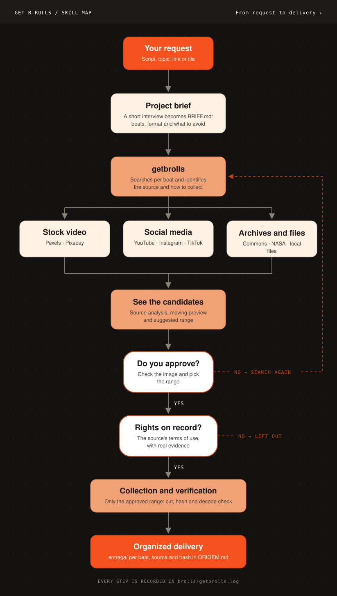
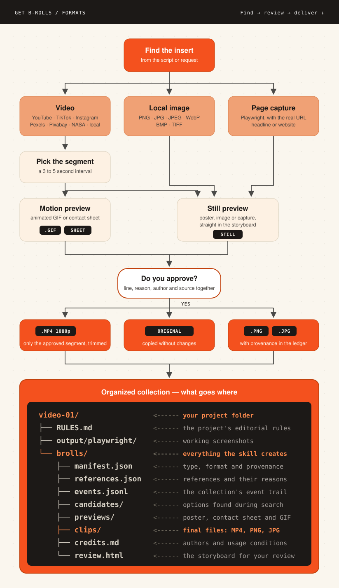

<div align="center">
  <p><a href="README.md">Português</a> · <strong>English</strong></p>
  
  <h1>GET BROLLS</h1>
  <p><strong>From an idea to the right shot for your edit.</strong></p>
  <p>Find supporting footage, preview the motion, and review every choice<br>before receiving the final clips with their sources.</p>
  <p>Created by <a href="https://www.instagram.com/zbrunomoreira/"><strong>Bruno Moreira (@zbrunomoreira)</strong></a>, Video Engineer</p>
  <p><a href="#getting-started">Getting started</a> · <a href="#plugins">Plugins</a> · <a href="#documentation">Documentation</a> · <a href="docs/MANUAL.md">Manual and tutorial</a> · <a href="docs/GUIDE.md#instalação">Full guide</a></p>
  <p align="center">
    
    
    
    
    
    
    
    
    
    
    <a href="https://www.instagram.com/zbrunomoreira/"></a>
  </p>
</div>

getbrolls is a skill for collecting the videos and images that support a line, illustrate an idea, or show the exact person, product, or event mentioned in a script. You describe what you need; the agent researches, prepares previews, and gathers the options into a storyboard for your review.

- **Choose with context.** Each shot can include the supplied narration, selection rationale, time range, creator, and original source.
- **See it before deciding.** GIFs and contact sheets help you evaluate action, framing, and on-screen text.
- **Receive an organized collection.** Final clips are delivered with a record of their origin, review decision, and conditions of use.
- **From script to your editor's folder.** A video can start from a `ROTEIRO.md` you review and leave as an editing project through a plugin (experimental).

The agent looks for the literal source of what you mention: the actual fact, person, product, news item, or screen. Stock-footage libraries are used only when you explicitly ask for stock. You do not need a complete script to request a single insert: simply explain what should appear.

A preview may download working media so you can see the motion. Final delivery requires a human decision and a record of the source's conditions of use. If the time range or context changes, the shot returns to review.

getbrolls does not edit or render the video. It collects, previews and delivers the clips with their origin and conditions of use; your editor or HyperFrames assembles and renders.

## How it works

<p align="center"></p>

There are eight steps, like an editing workflow: ingest, selection, client approval and delivery.

1. **Check** that the machine is ready (`doctor`).
2. **Plan** the video: channel rules (`RULES.md`), a per-beat plan (`BRIEF.md`) or the script (`ROTEIRO.md`).
3. **Search** for candidates. Nothing is downloaded yet.
4. **Preview** as a GIF and contact sheet, and build the Storyboard.
5. **Approve** the shot (first lock).
6. **Record the rights** to use it (second lock).
7. **Download** only the approved range, checked by hash.
8. **Deliver** one folder per beat, with an `ORIGEM.md` next to each clip.

### What it collects

<p align="center"></p>

## What's new in 2.6

- **A terminal command.** getbrolls installs as the `getbrolls` command. `setup` prepares yt-dlp and Playwright, and `doctor` tells you whether it is ready.
- **The video starts from the script.** You write the scenes in a `ROTEIRO.md`, review the text, and the B-roll beats come from it. Only the `reels` genre, experimental.
- **Projects with `project.json`.** `init` creates the video folder with `aroll/`, `assets/`, `broll/` and `analysis/`. A 2.5 project stays as it is.
- **Clients and recipes.** Each client's brand, sounds and music live in a folder of their own. A new project can start from a client recipe.
- **Your footage becomes data.** `analysis` gives each project media file an id computed from its content and records duration, frame and codecs.
- **Plugins.** New sources, download routes, commands and exporters, installed in two steps and pinned by sha256. The official HyperFrames bridge ships in the package.
- **Direct links and embedded players.** `resolve --url` accepts a `.m3u8`/`.mp4` link and a page with an embedded video player.
- **A contract for agents.** `capabilities --json` describes commands and exit codes. An operation error now exits with `1`.

Coming from 2.5? See [Updating from 2.5 to 2.6](docs/GUIDE.md#atualizar-da-25-para-a-26) (in Portuguese). The full list is in the [CHANGELOG](CHANGELOG.md).

## Getting started

### 0. Install the whole stack

The skill only works fully with **all** of the tools below. Without one of them, collection runs halfway and the Storyboard has no preview.

| Tool | Used for | Without it |
|---|---|---|
| Python 3.11+ | CLI, project record, Instagram collection | nothing runs |
| FFmpeg + ffprobe **with libfreetype** (`drawtext`) | poster, numbered contact sheet, GIF, cuts | no preview; without `drawtext`, the sheet has no numbers or timecodes |
| Node 22+ with npm/npx | Playwright CLI and the yt-dlp EJS runtime | YouTube and Instagram fail |
| curl | downloading Instagram stream pairs | Instagram fails |
| Git | cloning and updating | manual installation |
| yt-dlp and Playwright CLI | installed into `$GB_HOME/runtime` by `setup`, in step 1 | YouTube/TikTok and Instagram fail |

macOS (Homebrew):

```sh
brew install python ffmpeg node git curl
```

Windows (winget, PowerShell 5.1 is enough):

```powershell
winget install Python.Python.3.13 Gyan.FFmpeg OpenJS.NodeJS.LTS Git.Git
```

Ubuntu/Debian (secondary platform):

```sh
sudo apt install python3 python3-venv ffmpeg nodejs npm curl git
```

### 1. Choose how to use it

There are three ways. Pick one.

#### In Claude Code (plugin)

Paste these two lines into Claude Code:

```text
/plugin marketplace add engenheirodevideo/get-brolls
/plugin install get-brolls@engenheirodevideo
```

Then ask for `/get-brolls:get-brolls-setup`. It installs the runtime into `$GB_HOME/runtime` and answers in one line whether it is ready. The agent runs the commands for you.

#### As a terminal command

```sh
uv tool install git+https://github.com/engenheirodevideo/get-brolls@v2.6.1
getbrolls setup
getbrolls doctor
```

With pipx, replace the first line with `pipx install git+https://github.com/engenheirodevideo/get-brolls@v2.6.1`. Seeing `getbrolls: command not found`? Run `uv tool update-shell` (or `pipx ensurepath`) and open a new terminal.

The examples in this README use the `getbrolls …` command. In a clone, without installing the package, `python3 scripts/gb.py …` runs the same commands (on Windows, `python scripts/gb.py …`; from another folder, use the absolute path of `scripts/gb.py`).

#### As a skill (Codex, Claude Code and other agents)

```sh
git clone https://github.com/engenheirodevideo/get-brolls.git
cd get-brolls
```

Copy the folder to your agent's skills location:

| Agent | Personal install | Inside a project | How to call it |
|---|---|---|---|
| Codex | `~/.agents/skills/get-brolls/` | `.agents/skills/get-brolls/` | `$get-brolls` |
| Claude Code | `~/.claude/skills/get-brolls/` | `.claude/skills/get-brolls/` | `/get-brolls` |
| Other agents | the agent's skills folder | the project's skills folder, if any | by name, `get-brolls` |

When copying, leave out `.venv/`, `.tools/`, caches, projects and private files. In the final folder, run your system's installer and check with that folder's own script (a `getbrolls` on the `PATH`, if any, may be another installation).

macOS and Linux:

```sh
bash scripts/install.sh --check
bash scripts/install.sh
python3 scripts/gb.py doctor
```

Windows PowerShell:

```powershell
powershell -ExecutionPolicy RemoteSigned -File scripts/install.ps1 -Check
powershell -ExecutionPolicy RemoteSigned -File scripts/install.ps1
python scripts/gb.py doctor
```

`--check` only checks the prerequisites. The installer calls `setup`, which installs yt-dlp and Playwright CLI into `$GB_HOME/runtime`, outside the skill folder. A folder that came from a zip may need `Unblock-File -Path scripts\*.ps1` once, done by you. Outside Claude Code there are no slash commands: ask for the step in words. [Installation in detail.](docs/GUIDE.md#instalação)

### 2. Check

It is ready when `doctor` answers `ready: true` and exits with `0`. When something is missing, it exits with `4` and lists it in `summary.missing`, each item with the command that fixes it.

With the whole stack, `doctor` also shows `contact_sheet.labels: true`. If `drawtext` appears in `summary.optional`, your FFmpeg came without libfreetype: on macOS, `brew reinstall ffmpeg`.

### First B-roll in 5 minutes

It uses NASA, which needs no key. Run one at a time, in order. Replace `/path/my-video` with your video folder and `<ID>` with the code the search returns. Keep the quotes. Want every command explained? See the [manual and tutorial](docs/MANUAL.md) (in Portuguese).

```sh
getbrolls init --project /path/my-video
getbrolls search --provider nasa --query "Artemis launch" --limit 3 --project /path/my-video
getbrolls preview --candidate "<ID>" --start 0 --end 4 --project /path/my-video
getbrolls review --project /path/my-video
getbrolls serve --background --project /path/my-video
```

Open the link `serve` returned, click Approve and then **Save decisions**. Always open it through the link: over `file://` saving may not work.

```sh
getbrolls import-review --by "Your name" --project /path/my-video
getbrolls serve --stop --project /path/my-video
getbrolls permit --candidate "<ID>" --preset nasa --project /path/my-video
getbrolls fetch --candidate "<ID>" --project /path/my-video
getbrolls verify --project /path/my-video
getbrolls deliver --project /path/my-video
```

Done: the clip is in `broll/`, and `entrega/` has one folder per beat with the `ORIGEM.md` saying where it came from. Without a `BRIEF.md`, it lands in `entrega/00-sem-beat/`. The `nasa` preset records NASA's standard terms: check the video's page anyway.

### Chat only

If you have never opened a terminal, this is the whole list. Every step is a conversation with the agent.

1. **Install once.** Ask for `/get-brolls:get-brolls-setup`. It installs everything into `$GB_HOME/runtime` and answers in one line whether it is ready. The runtime survives `/plugin update`.
2. **Say what you need.** `/get-brolls I need supporting footage for my Reel about X` — and also say which folder the project goes in.
3. **Answer the interview.** The agent asks at most seven questions, one at a time. "Whatever" is a valid answer: it picks a default and shows what it assumed. To call it directly, use `/get-brolls:get-brolls-brief`.
4. **Check the brief.** It gives back in five lines what it understood and asks "shall I lock it?". Correct it right there.
5. **Look at the shortlist.** Before downloading anything, it lists 5 to 8 candidates with title, creator and the exact range. Say which ones work.
6. **Approve the previews.** In chat ("approved all", or naming which ones) or in the Storyboard: ask for `/get-brolls:get-brolls-review`, open the link, decide each shot, click **Save decisions** and come back to say you saved.
7. **Say who owns the material.** The agent records the conditions of use with what you tell it. You are responsible for those conditions.
8. **Receive.** The clips come out in `entrega/`, one folder per shot, with an `ORIGEM.md` saying where each one came from.
9. **Lost track?** Ask for `/get-brolls:get-brolls-status`: it tells you where things stand and what the next step is.

## What goes where in the video folder

In a project created with `init`:

```text
my-video/
├── project.json     # project identity (layout 1)
├── ROTEIRO.md       # optional: the script, scene by scene
├── BRIEF.md         # the per-beat B-roll plan
├── RULES.md         # the channel standard: format, sources, blocked sites
├── aroll/           # your recordings, one per scene (c01.mp4…)
├── assets/          # marca, lettering, sfx, musica, imagem, composicao, outros
├── broll/           # ⭐ the final clips: point your editor here
├── entrega/         # one folder per beat, with ORIGEM.md, to check and send
├── analysis/        # what is known about each media file, by content id
├── exports/         # editing projects generated by a plugin exporter
└── brolls/          # the skill's backstage: manifest, previews, Storyboard, logs
```

**`broll/` is not `brolls/`.** `broll/` (no s) holds the final clips, checked by sha256. `brolls/` (with s) is the backstage: do not touch it. `entrega/` is renumbered when the beat order changes: use it to check and to send to someone, not as the editor's folder.

A 2.5 project, without `project.json`, stays as it is: the clips stay in `brolls/clips/`. `migrate --action plan` shows the adoption; `apply` only adds `project.json`, without moving anything. Outside the project, in `$GB_HOME` (default `~/.getbrolls`), live the runtime, the plugins, the client registry, the library and the `RULES.md` that applies to every video.

## Plugins

A plugin adds a search source, a download route, a command of its own (`getbrolls x`) or an editing-project exporter to getbrolls. It is not the Claude Code plugin: it extends getbrolls itself.

| Kind | Where it lives in this repository | How it reaches you |
|---|---|---|
| Official bridge | `plugins/bridges/` | Ships in the package, checked by the core. Today: the [HyperFrames bridge](plugins/bridges/hyperframes/README.md). |
| Official getbrolls plugin | [`plugins/getbrolls/`](plugins/getbrolls/README.md) | Would ship in the package, like the bridges. There are none today. |
| Community | [`plugins/community/`](plugins/community/README.md) | Written by third parties, in their own repository, listed by a marketplace. |
| Example | `plugins/examples/` | Models to copy: [`pasta_local`](plugins/examples/pasta_local/README.md), [`banco_http`](plugins/examples/banco_http/README.md) and [`exporter_example`](plugins/examples/exporter_example/README.md). |

On your machine, every installed plugin lives in a single folder: `$GB_HOME/plugins/` (default `~/.getbrolls/plugins/`). Installing always takes two steps:

```sh
getbrolls plugins --action install --source <plugin folder or git URL>
getbrolls plugins --action install --source <plugin folder or git URL> --yes --expect <sha256 from the preview>
```

The first one only shows the manifest, the permissions, the origin and the content `sha256`. After reading the code and the permissions, the second one installs and enables it. From a marketplace, the same goes for `--id <id>@<marketplace>`.

- `plugins --action list` shows each plugin with its status and origin; the official bridges are listed apart.
- A local plugin is not verified by anyone: getbrolls only checks that the content is what you approved. It runs only after you enable it, and if the content changes it is suspended until you review it again.
- A local plugin that uses the id of a bridge or of an official plugin is refused.
- A plugin runs as your own code, with no sandbox: install only what you have read.

**The HyperFrames bridge.** getbrolls collects, previews and delivers the clips with their origin and conditions of use. HyperFrames itself (or your editor) assembles and renders the video. The bridge only hands off between the two: getbrolls does not export a HyperFrames timeline, and that is by design. `getbrolls environment --action list` shows its version and status.

Using plugins: [Manual → Plugins](docs/MANUAL.md#plugins) (in Portuguese). Writing one: [quickstart](docs/PLUGIN_DEV_QUICKSTART.md) and [SDK reference](docs/SDK.md).

## Sources

`getbrolls providers` lists ten sources. Five have keyword search: YouTube, Pexels, Pixabay, Wikimedia Commons and NASA.

| Source | How to find | How to obtain |
|---|---|---|
| **YouTube** | Keyword search or URL | yt-dlp + FFmpeg; no API key. |
| **Instagram** | Reel found in the browser | Capture video and audio from the same Reel; the included collector joins the channels. |
| **TikTok** | Full URL discovered in the browser | yt-dlp + FFmpeg; no API key. |
| **Pexels / Pixabay** | Search through the libraries' APIs | That library's key; HTTPS download. |
| **Wikimedia Commons / NASA** | Search through the public APIs | HTTPS download; no key. |
| **Direct link** (`direct_stream`) | `resolve --url` of a `.m3u8` or `.mp4` | yt-dlp, public HTTPS only. |
| **Page with an embedded player** (`embedded_player`) | `resolve --url` of the page | The player is read once; the video goes through yt-dlp. |
| **Local file** (`local`) | Supplied video, image or capture | Local import with origin and credit, when provided. |

Pexels and Pixabay are used only when you explicitly ask for stock. The default is the literal source of what the narration mentions.

Instagram and TikTok depend on the URL found in the browser; there is no keyword search in them. For Instagram, the agent operates the authorized browser and hands both streams to the collector: see the [Instagram guide](docs/GUIDE.md#instagram--navegadorplaywright-dois-streams-e-mp4) (in Portuguese).

The Instagram collector accepts only public HTTPS URLs without credentials, rejects resolution to local networks and does not follow redirects. How real runs are recorded, and the known limits, are in [Quality and evidence](docs/QUALITY.md).

## Commands

One line per command, in the order of the workflow. Each one explains what it accepts with `getbrolls <command> --help`, and `getbrolls --help` lists them all.

| Stage | Command | What it does |
|---|---|---|
| Prepare | `setup` | Installs the runtime (yt-dlp and Playwright) into `$GB_HOME/runtime`; `--check` only checks |
| Prepare | `doctor` | Says whether the installation is ready (`ready`) and what is missing |
| Prepare | `providers` | Lists the sources, the transport and the configured keys |
| Prepare | `profile` | Shows the `getbrolls.toml` profile in effect, or trusts it |
| Plan | `init` | Creates a new project with `project.json` |
| Plan | `migrate` | Adopts the new layout in an old project, without moving anything |
| Plan | `init-rules` · `rules` | Creates `RULES.md` · shows the rules in effect |
| Plan | `init-brief` · `brief` | Creates `BRIEF.md` · shows the beats and each one's command |
| Plan | `status` | Says where the project is and what the next step is; read-only |
| Search | `search` | Searches a source and records the candidates |
| Search | `resolve` | Records a candidate from a URL or a local file |
| Search | `inspect` | Reads duration, chapters and captions before you pick the range |
| Search | `browser-plan` | Plans a page capture through the browser |
| Search | `queue` | Paced queue for Instagram, TikTok and YouTube batches |
| Review | `preview` | Generates a GIF and a contact sheet of the range |
| Review | `review` · `serve` | Builds the Storyboard · opens it in the browser |
| Approve | `import-review` | Brings in the decisions saved in the Storyboard |
| Approve | `approve` · `reject` | Records an approval you received · discards with the reason |
| Rights | `permit` | Records the shot's conditions of use |
| Deliver | `fetch` · `verify` | Downloads the approved cut · checks each file |
| Deliver | `deliver` | Organizes `entrega/`, one folder per beat |
| Memory | `remember` · `references` | Saves and looks up this project's decisions |
| Memory | `learn` · `library` | Saves and looks up what applies to every project |
| Script | `roteiro` | Creates, checks, reviews and syncs `ROTEIRO.md` |
| Script | `assets` | Lists the components and says where each name resolves |
| Script | `export` | Turns the reviewed script into an editing project, through a plugin exporter |
| Media | `analysis` | Records the project's media and checks `analysis/` |
| Clients | `client` · `recipe` | Registers client folders · lists and checks the recipes |
| Plugins | `plugins` · `x` | Installs and manages plugins · runs a plugin command |
| Plugins | `environment` | Lists the official bridges, without running their code |
| Agents | `capabilities` | Describes commands, flags and exit codes in JSON |

## Limits and privacy

Project files and imported originals stay local. Remote search and acquisition connect only to the sources you choose. Keep keys, browser sessions and signed URLs in a private environment.

The Storyboard is for trusted local projects and has no reviewer authentication. Share only what the review needs: `brolls/review.html` with the `brolls/previews/` folder next to it, never the whole `brolls/` folder. Recording a decision does not check the license: whoever produces the video is responsible for its use.

Final resolution depends on the source: prefer 1080p when available and check the real dimensions. The tool does not assemble or render the video, does not search images outside NASA and Commons, and does not deliver isolated audio as a final asset.

Run one command per project at a time. If the record was saved and the page failed, run `review` again. See [compatibility](docs/GUIDE.md#compatibilidade) (in Portuguese).

## Documentation

Most documents below are in Portuguese (`.env.example` is in English).

| For users | |
|---|---|
| [Manual and tutorial](docs/MANUAL.md) | Start here: tutorial, every command explained, script, clients, plugins and how to read the answer. |
| [Full guide](docs/GUIDE.md) | Installation, updating from 2.5, sources, browser, Instagram, project folders and Storyboard. |
| [BRIEF.md](docs/BRIEF.md) · [RULES.md](docs/RULES.md) · [.env.example](.env.example) | The files you edit. |
| [CHANGELOG](CHANGELOG.md) | What changed in each version. |

| Technical reference | |
|---|---|
| [Documentation index](docs/README.md) | Every document, by audience. |
| [Plugin quickstart](docs/PLUGIN_DEV_QUICKSTART.md) · [SDK](docs/SDK.md) | Writing plugins: manifest, sources, routes, commands, exporters and marketplaces. |
| [CLI contract](docs/CLI_CONTRACT.md) · [File formats](docs/SCHEMAS.md) | Output, exit and error codes, warnings and the format of every file written. |
| [Security](docs/SECURITY.md) · [Quality](docs/QUALITY.md) | Private data, network, plugins, evidence and known limits. |
| [AGENTS.md](AGENTS.md) · [SKILL.md](SKILL.md) | Repository map for agents and the skill's operating contract. |
| [Contributing](CONTRIBUTING.md) · [Checklist](docs/CHECKLIST.md) · [Code style](docs/CODE_STYLE.md) | For people changing the code. |

## Author

Created and maintained by **Bruno Moreira — Engenheiro de Vídeo**. Follow [Bruno Moreira (@zbrunomoreira) on Instagram](https://www.instagram.com/zbrunomoreira/).

Code under the [MIT license](LICENSE). External dependencies keep their own terms, described in the [third-party notices](THIRD_PARTY_NOTICES.md).
