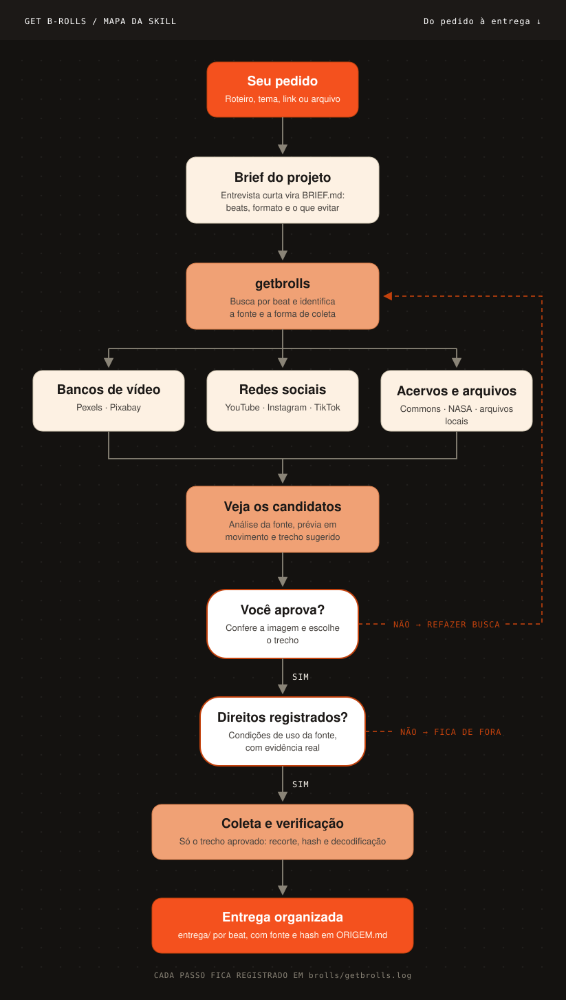
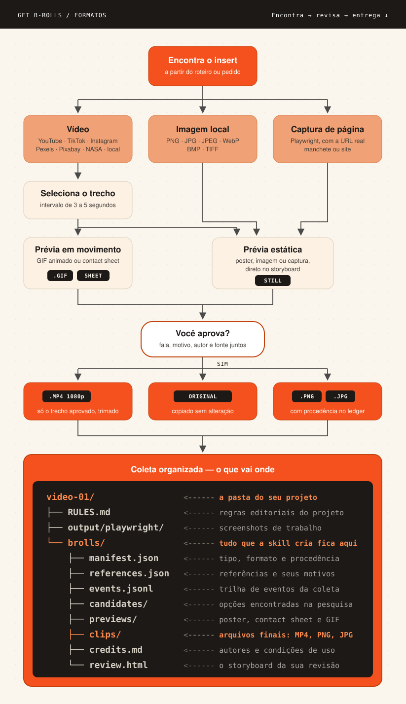

<div align="center">
  <p><strong>Português</strong> · <a href="README.en.md">English</a></p>
  
  <h1>GET B-ROLLS</h1>
  <p><strong>Da ideia ao trecho certo para a sua edição.</strong></p>
  <p>Encontre imagens de apoio, veja o movimento e revise cada escolha<br>antes de receber os cortes finais com suas fontes.</p>
  <p>Criado por <a href="https://www.instagram.com/zbrunomoreira/"><strong>Bruno Moreira (@zbrunomoreira)</strong></a>, Engenheiro de Vídeo</p>
  <p><a href="#comece-aqui">Comece aqui</a> · <a href="#plugins">Plugins</a> · <a href="#documentação">Documentação</a> · <a href="docs/MANUAL.md">Manual e tutorial</a> · <a href="docs/GUIDE.md#instalação">Guia completo</a></p>
  <p align="center">
    
    
    
    
    
    
    
    
    
    
    <a href="https://www.instagram.com/zbrunomoreira/"></a>
  </p>
</div>

O getbrolls é uma skill para coletar os vídeos e imagens que apoiam uma fala, ilustram uma ideia ou mostram exatamente a pessoa, o produto e o acontecimento citados no roteiro. Você descreve o que precisa; o agente pesquisa, prepara as prévias e reúne as escolhas em um storyboard para sua revisão.

- **Escolha com contexto.** Cada trecho pode reunir fala, motivo da escolha, intervalo, autor e fonte original.
- **Veja antes de decidir.** GIFs e sequências de quadros ajudam a avaliar ação, enquadramento e textos sobrepostos.
- **Receba uma coleta organizada.** Os cortes finais ficam junto de um registro de origem, revisão e condições de uso.
- **Do roteiro à pasta do editor.** O vídeo pode nascer de um `ROTEIRO.md` revisado por você e sair como projeto de edição por um plugin (experimental).

O agente procura a fonte literal do que você cita: o fato, a pessoa, o produto, a notícia ou a tela reais. Bancos de vídeo entram somente quando você pedir stock explicitamente. Um único insert funciona sem roteiro completo: basta explicar o que precisa aparecer.

A prévia pode baixar mídia de trabalho para mostrar o movimento. A entrega final depende da decisão humana e do registro das condições de uso da fonte. Se o intervalo ou o contexto mudar, o trecho volta para revisão.

O getbrolls não edita nem renderiza o vídeo. Ele coleta, mostra a prévia e entrega os clipes com origem e condições de uso; quem monta e renderiza é o seu editor ou o HyperFrames.

## Como funciona

<p align="center"></p>

São oito passos, como num fluxo de edição: ingest, seleção, aprovação do cliente e entrega.

1. **Conferir** se a máquina está pronta (`doctor`).
2. **Planejar** o vídeo: regras do canal (`RULES.md`), plano por beat (`BRIEF.md`) ou o roteiro (`ROTEIRO.md`).
3. **Buscar** candidatos. Nada é baixado ainda.
4. **Ver a prévia** em GIF e folha de quadros, e montar o Storyboard.
5. **Aprovar** o trecho (primeira trava).
6. **Registrar os direitos** de uso (segunda trava).
7. **Baixar** só o trecho aprovado, conferido por hash.
8. **Entregar** uma pasta por beat, com um `ORIGEM.md` ao lado de cada corte.

### O que ela coleta

<p align="center"></p>

## Novidades da 2.6

- **Comando no terminal.** O getbrolls instala como o comando `getbrolls`. O `setup` prepara o yt-dlp e o Playwright, e o `doctor` diz se está pronto.
- **O vídeo nasce do roteiro.** Você escreve as cenas num `ROTEIRO.md`, revisa o texto e os beats de b-roll nascem dele. Só gênero `reels`, experimental.
- **Projeto com `project.json`.** O `init` cria a pasta do vídeo com `aroll/`, `assets/`, `broll/` e `analysis/`. Projeto da 2.5 continua igual.
- **Clientes e receitas.** A marca, os sons e as trilhas de cada cliente ficam numa pasta dele. Um projeto novo pode nascer de uma receita do cliente.
- **Seu material vira dado.** O `analysis` dá a cada mídia do projeto um id calculado pelo conteúdo e grava duração, quadro e codecs.
- **Plugins.** Fontes, rotas de download, comandos e exportadores novos, instalados em dois passos e travados por sha256. A ponte oficial do HyperFrames já vem no pacote.
- **Link direto e player embutido.** O `resolve --url` aceita link `.m3u8`/`.mp4` e página com player de vídeo embutido.
- **Contrato para agentes.** `capabilities --json` descreve comandos e códigos de saída. Erro de operação agora sai com `1`.

Vindo da 2.5? Veja [Atualizar da 2.5 para a 2.6](docs/GUIDE.md#atualizar-da-25-para-a-26). A lista completa está no [CHANGELOG](CHANGELOG.md).

## Comece aqui

### 0. Instale a stack inteira

A skill só funciona completa com **todas** as ferramentas abaixo. Sem uma delas, a coleta roda pela metade e o Storyboard sai sem prévia.

| Ferramenta | Para quê | Sem ela |
|---|---|---|
| Python 3.11+ | CLI, registro do projeto, coleta do Instagram | nada roda |
| FFmpeg + ffprobe **com libfreetype** (`drawtext`) | poster, folha de quadros numerada, GIF, cortes | sem prévia; sem `drawtext`, a folha sai sem número e timecode |
| Node 22+ com npm/npx | Playwright CLI e runtime EJS do yt-dlp | YouTube e Instagram falham |
| curl | download dos pares de stream do Instagram | Instagram falha |
| Git | clonar e atualizar | instalação manual |
| yt-dlp e Playwright CLI | instalados em `$GB_HOME/runtime` pelo `setup`, no passo 1 | YouTube/TikTok e Instagram falham |

macOS (Homebrew):

```sh
brew install python ffmpeg node git curl
```

Windows (winget, PowerShell 5.1 já serve):

```powershell
winget install Python.Python.3.13 Gyan.FFmpeg OpenJS.NodeJS.LTS Git.Git
```

Ubuntu/Debian (plataforma secundária):

```sh
sudo apt install python3 python3-venv ffmpeg nodejs npm curl git
```

### 1. Escolha como usar

São três jeitos. Escolha um.

#### No Claude Code (plugin)

Cole estas duas linhas no Claude Code:

```text
/plugin marketplace add engenheirodevideo/get-brolls
/plugin install get-brolls@engenheirodevideo
```

Depois peça `/get-brolls:get-brolls-setup`. Ele instala o runtime em `$GB_HOME/runtime` e responde em uma linha se está pronto. O agente roda os comandos por você.

#### Como comando no terminal

```sh
uv tool install git+https://github.com/engenheirodevideo/get-brolls@v2.6.0
getbrolls setup
getbrolls doctor
```

Com o pipx, troque a primeira linha por `pipx install git+https://github.com/engenheirodevideo/get-brolls@v2.6.0`. Apareceu `getbrolls: command not found`? Rode `uv tool update-shell` (ou `pipx ensurepath`) e abra um terminal novo.

Os exemplos deste README usam o comando `getbrolls …`. Num clone, sem instalar o pacote, `python3 scripts/gb.py …` roda os mesmos comandos (no Windows, `python scripts/gb.py …`; de outra pasta, use o caminho absoluto de `scripts/gb.py`).

#### Como skill (Codex, Claude Code e outros agentes)

```sh
git clone https://github.com/engenheirodevideo/get-brolls.git
cd get-brolls
```

Copie a pasta para o lugar de skills do seu agente:

| Agente | Instalação pessoal | Dentro de um projeto | Como chamar |
|---|---|---|---|
| Codex | `~/.agents/skills/get-brolls/` | `.agents/skills/get-brolls/` | `$get-brolls` |
| Claude Code | `~/.claude/skills/get-brolls/` | `.claude/skills/get-brolls/` | `/get-brolls` |
| Outros agentes | a pasta de skills do agente | a pasta de skills do projeto, se houver | pelo nome, `get-brolls` |

Ao copiar, deixe de fora `.venv/`, `.tools/`, caches, projetos e arquivos privados. Na pasta final, rode o instalador do seu sistema e confira com o script da própria pasta (o `getbrolls` do `PATH`, se houver, pode ser outra instalação).

macOS e Linux:

```sh
bash scripts/install.sh --check
bash scripts/install.sh
python3 scripts/gb.py doctor
```

Windows PowerShell:

```powershell
powershell -ExecutionPolicy RemoteSigned -File scripts/install.ps1 -Check
powershell -ExecutionPolicy RemoteSigned -File scripts/install.ps1
python scripts/gb.py doctor
```

O `--check` só confere os pré-requisitos. O instalador chama o `setup`, que instala yt-dlp e Playwright CLI em `$GB_HOME/runtime`, fora da pasta da skill. Uma pasta que veio de um zip pode precisar de `Unblock-File -Path scripts\*.ps1` uma vez, feito por você. Fora do Claude Code não existe comando de barra: peça o passo em palavras. [Instalação em detalhe.](docs/GUIDE.md#instalação)

### 2. Confira

Está pronto quando o `doctor` responde `ready: true` e sai com `0`. Faltando algo, ele sai com `4` e lista o que falta em `summary.missing`, cada item com o comando que resolve.

Com a stack inteira, o `doctor` também mostra `contact_sheet.labels: true`. Se aparecer `drawtext` em `summary.optional`, o seu FFmpeg veio sem libfreetype: no macOS, `brew reinstall ffmpeg`.

### Primeiro B-roll em 5 minutos

Usa a NASA, que não pede chave. Rode um por vez, na ordem. Troque `/caminho/meu-video` pela pasta do seu vídeo e `<ID>` pelo código que a busca devolver. Mantenha as aspas. Quer cada comando explicado? Veja o [manual e tutorial](docs/MANUAL.md).

```sh
getbrolls init --project /caminho/meu-video
getbrolls search --provider nasa --query "Artemis launch" --limit 3 --project /caminho/meu-video
getbrolls preview --candidate "<ID>" --start 0 --end 4 --project /caminho/meu-video
getbrolls review --project /caminho/meu-video
getbrolls serve --background --project /caminho/meu-video
```

Abra o link que o `serve` devolveu, clique em Aprovar e depois em **Salvar decisões**. Abra sempre pelo link: por `file://` o salvamento pode não funcionar.

```sh
getbrolls import-review --by "Seu nome" --project /caminho/meu-video
getbrolls serve --stop --project /caminho/meu-video
getbrolls permit --candidate "<ID>" --preset nasa --project /caminho/meu-video
getbrolls fetch --candidate "<ID>" --project /caminho/meu-video
getbrolls verify --project /caminho/meu-video
getbrolls deliver --project /caminho/meu-video
```

Pronto: o corte está em `broll/`, e a `entrega/` tem uma pasta por beat com o `ORIGEM.md` dizendo de onde ele veio. Sem `BRIEF.md`, ele cai em `entrega/00-sem-beat/`. O preset `nasa` grava os termos padrão da NASA: confira mesmo assim a página do vídeo.

### Só pelo chat

Se você nunca abriu um terminal, esta é a lista inteira. Todos os passos são conversa com o agente.

1. **Instale uma vez.** Peça `/get-brolls:get-brolls-setup`. Ele instala tudo em `$GB_HOME/runtime` e responde em uma linha se está pronto. O runtime sobrevive ao `/plugin update`.
2. **Diga o que você precisa.** `/get-brolls preciso de vídeos de apoio pro meu Reel sobre X` — e diga também em que pasta o projeto vai ficar.
3. **Responda à entrevista.** O agente faz no máximo sete perguntas, uma por vez. "Tanto faz" é resposta válida: ele assume um padrão e mostra o que assumiu. Para chamar direto, use `/get-brolls:get-brolls-brief`.
4. **Confira o brief.** Ele devolve em cinco linhas o que entendeu e pergunta "fecho assim?". Corrija ali mesmo.
5. **Olhe a shortlist.** Antes de baixar qualquer coisa, ele lista de 5 a 8 candidatos com título, autor e o trecho exato. Diga quais servem.
6. **Aprove as prévias.** Pelo chat ("aprovei todos", ou nomeando quais) ou pelo Storyboard: peça `/get-brolls:get-brolls-review`, abra o link, decida cada trecho, clique em **Salvar decisões** e volte para dizer que salvou.
7. **Diga de quem é o material.** O agente registra as condições de uso com o que você informar. Quem responde pelas condições é você.
8. **Receba.** Os cortes saem em `entrega/`, uma pasta por trecho, com um `ORIGEM.md` dizendo de onde veio cada um.
9. **Perdeu o fio?** Peça `/get-brolls:get-brolls-status`: ele diz em que pé está e qual é o próximo passo.

## O que vai onde, na pasta do vídeo

Num projeto criado com `init`:

```text
meu-video/
├── project.json     # identidade do projeto (layout 1)
├── ROTEIRO.md       # opcional: o roteiro por cenas
├── BRIEF.md         # o plano de b-rolls por beat
├── RULES.md         # o padrão do canal: formato, fontes, sites bloqueados
├── aroll/           # suas gravações, uma por cena (c01.mp4…)
├── assets/          # marca, lettering, sfx, musica, imagem, composicao, outros
├── broll/           # ⭐ os clipes finais: aponte o editor para cá
├── entrega/         # uma pasta por beat, com ORIGEM.md, para conferir e mandar
├── analysis/        # o que se sabe de cada mídia, pelo id de conteúdo
├── exports/         # projetos de edição gerados por um exportador de plugin
└── brolls/          # bastidor da skill: manifesto, prévias, Storyboard, logs
```

**`broll/` não é `brolls/`.** `broll/` (sem s) guarda os clipes finais, conferidos por sha256. `brolls/` (com s) é o bastidor: não mexa nele. A `entrega/` é renumerada quando a ordem dos beats muda: use para conferir e mandar para alguém, não como pasta do editor.

Projeto da 2.5, sem `project.json`, continua igual: os clipes ficam em `brolls/clips/`. O `migrate --action plan` mostra a adoção; o `apply` só acrescenta o `project.json`, sem mover nada. Fora do projeto, em `$GB_HOME` (padrão `~/.getbrolls`), ficam o runtime, os plugins, o registro de clientes, a biblioteca e o `RULES.md` que vale para todos os vídeos.

## Plugins

Um plugin acrescenta ao getbrolls uma fonte de busca, uma rota de download, um comando próprio (`getbrolls x`) ou um exportador de projeto de edição. Não é o plugin do Claude Code: é uma extensão do próprio getbrolls.

| Tipo | Onde fica neste repositório | Como chega até você |
|---|---|---|
| Ponte oficial | `plugins/bridges/` | Vem no pacote, conferida pelo core. Hoje: a [ponte HyperFrames](plugins/bridges/hyperframes/README.md). |
| Plugin oficial do getbrolls | [`plugins/getbrolls/`](plugins/getbrolls/README.md) | Viria no pacote, como as pontes. Hoje não há nenhum. |
| Comunidade | [`plugins/community/`](plugins/community/README.md) | Feito por terceiros, no repositório deles, listado por um marketplace. |
| Exemplo | `plugins/examples/` | Modelos para copiar: [`pasta_local`](plugins/examples/pasta_local/README.md), [`banco_http`](plugins/examples/banco_http/README.md) e [`exporter_example`](plugins/examples/exporter_example/README.md). |

Na sua máquina, todo plugin instalado mora numa pasta só: `$GB_HOME/plugins/` (padrão `~/.getbrolls/plugins/`). Instalar é sempre em dois passos:

```sh
getbrolls plugins --action install --source <pasta ou URL git do plugin>
getbrolls plugins --action install --source <pasta ou URL git do plugin> --yes --expect <sha256 da prévia>
```

O primeiro só mostra o manifesto, as permissões, a origem e o `sha256` do conteúdo. Depois de ler o código e as permissões, o segundo instala e habilita. De um marketplace, o mesmo vale para `--id <id>@<marketplace>`.

- `plugins --action list` mostra cada plugin com o estado e a origem; as pontes oficiais aparecem à parte.
- Um plugin local não tem a verificação de ninguém: o getbrolls só confere que o conteúdo é o que você aprovou. Ele só roda depois que você o habilita, e se o conteúdo mudar ele fica suspenso até você revisar de novo.
- Um plugin local com o id de uma ponte ou de um plugin oficial é recusado.
- Plugin roda como código seu, sem caixa de areia: instale só o que você leu.

**A ponte HyperFrames.** O getbrolls coleta, mostra a prévia e entrega os clipes com origem e condições de uso. Quem monta e renderiza o vídeo é o próprio HyperFrames (ou o seu editor). A ponte só faz a passagem entre os dois: o getbrolls não exporta uma timeline do HyperFrames, e isso é de propósito. `getbrolls environment --action list` mostra a versão e o estado dela.

Usar plugins: [Manual → Plugins](docs/MANUAL.md#plugins). Criar um: [guia rápido](docs/PLUGIN_DEV_QUICKSTART.md) e [referência do SDK](docs/SDK.md).

## Fontes

O `getbrolls providers` lista dez fontes. Cinco têm busca por palavra: YouTube, Pexels, Pixabay, Wikimedia Commons e NASA.

| Fonte | Como encontrar | Como obter |
|---|---|---|
| **YouTube** | Busca por palavras ou URL | yt-dlp + FFmpeg; sem API key. |
| **Instagram** | Reel encontrado no navegador | Captura de vídeo e áudio do mesmo Reel; coletor incluído une os canais. |
| **TikTok** | URL completa descoberta no navegador | yt-dlp + FFmpeg; sem API key. |
| **Pexels / Pixabay** | Busca nas APIs dos bancos | Chave do respectivo banco; download HTTPS. |
| **Wikimedia Commons / NASA** | Busca nas APIs públicas | Download HTTPS; sem chave. |
| **Link direto** (`direct_stream`) | `resolve --url` de um `.m3u8` ou `.mp4` | yt-dlp, só HTTPS público. |
| **Página com player embutido** (`embedded_player`) | `resolve --url` da página | O player é lido uma vez; o vídeo segue pelo yt-dlp. |
| **Arquivo local** (`local`) | Vídeo, imagem ou captura fornecida | Importação local com origem e autoria, quando informadas. |

Pexels e Pixabay entram somente quando você pede stock explicitamente. O padrão é a fonte literal do que a narração cita.

Instagram e TikTok dependem da URL achada no navegador; não há busca por palavra-chave neles. Para Instagram, o agente opera o navegador autorizado e entrega os dois streams ao coletor: veja o [guia Instagram](docs/GUIDE.md#instagram--navegadorplaywright-dois-streams-e-mp4).

O coletor do Instagram aceita somente URLs públicas HTTPS sem credenciais, rejeita resolução para redes locais e não segue redirecionamentos. Como os ensaios reais são registrados, e os limites conhecidos, está em [Qualidade e evidências](docs/QUALITY.md).

## Comandos

Uma linha por comando, na ordem do caminho. Cada um explica o que aceita com `getbrolls <comando> --help`, e `getbrolls --help` lista todos.

| Etapa | Comando | O que faz |
|---|---|---|
| Preparar | `setup` | Instala o runtime (yt-dlp e Playwright) em `$GB_HOME/runtime`; `--check` só confere |
| Preparar | `doctor` | Diz se a instalação está pronta (`ready`) e o que falta |
| Preparar | `providers` | Lista as fontes, o transporte e as chaves configuradas |
| Preparar | `profile` | Mostra o perfil `getbrolls.toml` em vigor, ou confia nele |
| Planejar | `init` | Cria um projeto novo com `project.json` |
| Planejar | `migrate` | Adota o layout novo num projeto antigo, sem mover nada |
| Planejar | `init-rules` · `rules` | Cria o `RULES.md` · mostra as regras em vigor |
| Planejar | `init-brief` · `brief` | Cria o `BRIEF.md` · mostra os beats e o comando de cada um |
| Planejar | `status` | Diz onde o projeto está e qual é o próximo passo; só lê |
| Buscar | `search` | Pesquisa numa fonte e registra os candidatos |
| Buscar | `resolve` | Registra um candidato por URL ou arquivo local |
| Buscar | `inspect` | Lê duração, capítulos e legendas antes de escolher o trecho |
| Buscar | `browser-plan` | Planeja a captura de uma página pelo navegador |
| Buscar | `queue` | Fila com ritmo para lotes de Instagram, TikTok e YouTube |
| Revisar | `preview` | Gera GIF e folha de quadros do trecho |
| Revisar | `review` · `serve` | Monta o Storyboard · abre ele no navegador |
| Aprovar | `import-review` | Traz as decisões salvas no Storyboard |
| Aprovar | `approve` · `reject` | Registra a aprovação recebida · descarta com o motivo |
| Direitos | `permit` | Registra as condições de uso do trecho |
| Entregar | `fetch` · `verify` | Baixa o corte aprovado · confere cada arquivo |
| Entregar | `deliver` | Organiza `entrega/`, uma pasta por beat |
| Memória | `remember` · `references` | Guarda e consulta as decisões deste projeto |
| Memória | `learn` · `library` | Guarda e consulta o que vale para todos os projetos |
| Roteiro | `roteiro` | Cria, confere, revisa e sincroniza o `ROTEIRO.md` |
| Roteiro | `assets` | Lista os componentes e diz onde cada nome resolve |
| Roteiro | `export` | Transforma o roteiro revisado em projeto de edição, por um exportador de plugin |
| Mídia | `analysis` | Registra as mídias do projeto e confere `analysis/` |
| Clientes | `client` · `recipe` | Registra pastas de cliente · lista e confere as receitas |
| Plugins | `plugins` · `x` | Instala e gerencia plugins · roda um comando de plugin |
| Plugins | `environment` | Lista as pontes oficiais, sem rodar código delas |
| Agentes | `capabilities` | Descreve em JSON comandos, flags e códigos de saída |

## Limites e privacidade

Os arquivos de projeto e os originais importados ficam locais. Pesquisa e aquisição remotas se conectam só às fontes escolhidas. Guarde chaves, sessão do navegador e URLs assinadas em ambiente privado.

O Storyboard é para projetos locais confiáveis e não tem autenticação de revisor. Compartilhe só o que a revisão precisa: `brolls/review.html` com a pasta `brolls/previews/` ao lado, nunca a pasta `brolls/` inteira. O registro de uma decisão não verifica a licença: quem responde pelo uso é quem produz o vídeo.

A resolução final depende da fonte: prefira 1080p quando houver e confira as dimensões reais. A ferramenta não monta nem renderiza o vídeo, não busca imagens fora da NASA e do Commons e não entrega áudio isolado como asset final.

Rode um comando por projeto de cada vez. Se o registro foi salvo e a página falhou, rode `review` de novo. Veja [compatibilidade](docs/GUIDE.md#compatibilidade).

## Documentação

| Para quem usa | |
|---|---|
| [Manual e tutorial](docs/MANUAL.md) | Comece por aqui: tutorial, cada comando explicado, roteiro, clientes, plugins e como ler a resposta. |
| [Guia completo](docs/GUIDE.md) | Instalação, atualização da 2.5, fontes, navegador, Instagram, pastas do projeto e Storyboard. |
| [BRIEF.md](docs/BRIEF.md) · [RULES.md](docs/RULES.md) · [.env.example.pt-BR](.env.example.pt-BR) | Os arquivos que você edita. |
| [CHANGELOG](CHANGELOG.md) | O que mudou em cada versão. |

| Referência técnica | |
|---|---|
| [Índice da documentação](docs/README.md) | Todos os documentos, por público. |
| [Guia rápido de plugins](docs/PLUGIN_DEV_QUICKSTART.md) · [SDK](docs/SDK.md) | Criar plugins: manifesto, fontes, rotas, comandos, exportadores e marketplaces. |
| [Contrato da CLI](docs/CLI_CONTRACT.md) · [Formatos de arquivo](docs/SCHEMAS.md) | Saída, códigos de saída e de erro, avisos e o formato de cada arquivo gravado. |
| [Segurança](docs/SECURITY.md) · [Qualidade](docs/QUALITY.md) | Dados privados, rede, plugins, evidências e limites conhecidos. |
| [AGENTS.md](AGENTS.md) · [SKILL.md](SKILL.md) | Mapa do repositório para agentes e o contrato de operação da skill. |
| [Contribuir](CONTRIBUTING.md) · [Checklist](docs/CHECKLIST.md) · [Estilo de código](docs/CODE_STYLE.md) | Para quem muda o código. |

## Autor

Criado e mantido por **Bruno Moreira — Engenheiro de Vídeo**. Siga [Bruno Moreira (@zbrunomoreira) no Instagram](https://www.instagram.com/zbrunomoreira/).

Código sob [licença MIT](LICENSE). Dependências externas mantêm suas próprias condições, descritas nos [avisos de terceiros](THIRD_PARTY_NOTICES.md).
